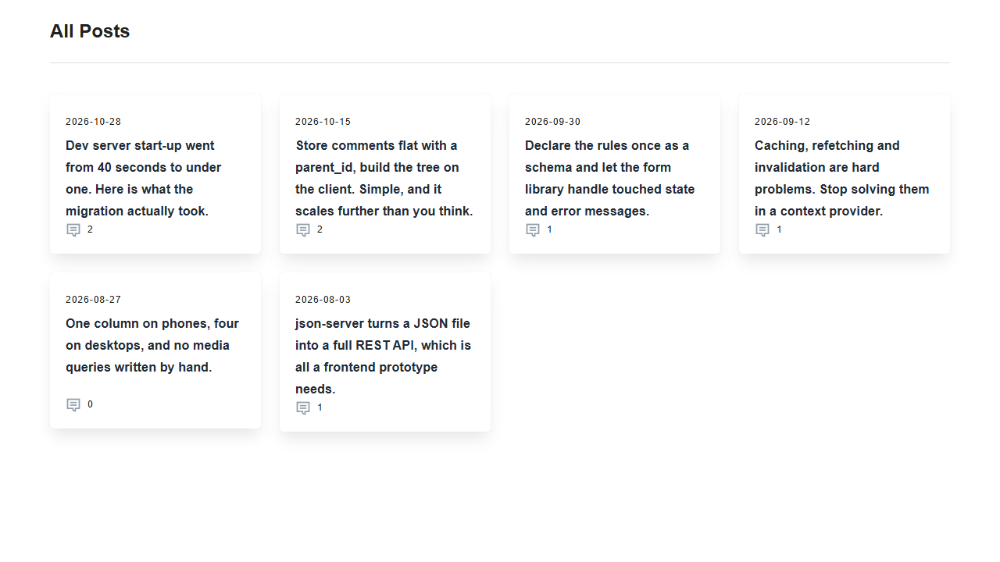
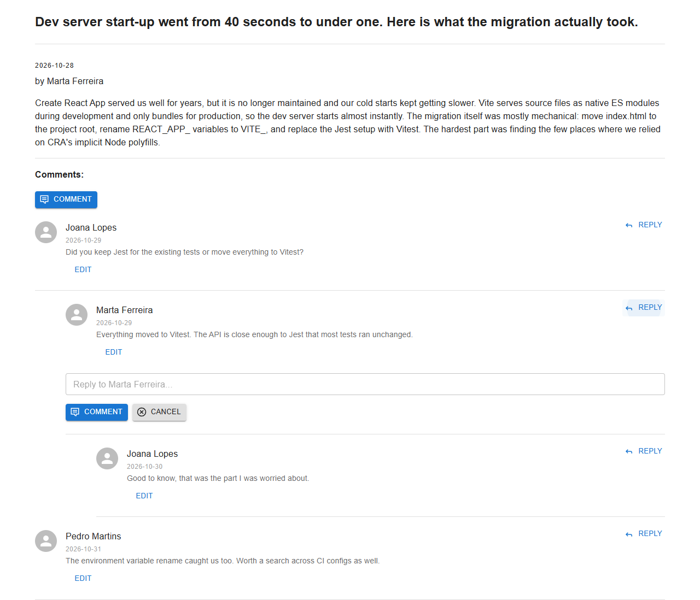

# Blog React App

A small blog built for a 2022 technical challenge: a feed of posts, a page per post, and threaded comments you can add, reply to and edit. Data comes from a REST API, mocked locally with [json-server](https://github.com/typicode/json-server).





## Getting started

Requires Node.js 20.19+ or 22.12+.

```bash
npm install
npm run dev
```

This starts the mock API on http://localhost:9000 and the app on http://localhost:5173.

The API reads and writes `db.json`, so comments you add are saved there. Run `git checkout db.json` to get the sample data back.

### Scripts

| Command | What it does |
| --- | --- |
| `npm run dev` | API + app together |
| `npm run dev:web` / `npm run api` | Only the app / only the API |
| `npm test` | Unit tests (Vitest) |
| `npm run lint` | ESLint |
| `npm run build` | Type-check and build to `dist/` |

### Configuration

The API base URL comes from `VITE_API_URL` (default in `.env`). To point the app at another API, override it in `.env.local`.

## Stack

- React 19 + TypeScript, built with Vite
- MUI for the UI
- TanStack Query for fetching and caching posts, axios for HTTP
- Formik + Yup for forms and validation
- React Router
- json-server as the mock backend
- Vitest and ESLint, run in CI by GitHub Actions

## How comments work

The API stores comments flat, and each reply points to its parent through `parent_id`. `_nest` in [src/utils/index.ts](src/utils/index.ts) builds the reply tree on the client in one pass, and the list renders it recursively with deeper indentation for each level. After you add or edit a comment, the posts query is invalidated and the tree is rebuilt from the server.

## Requirements

- [ ] **Feed lists all posts with title, author, date and description, newest first.** Partial: cards show the date and description. Title and author appear only on the post page, and the feed keeps the order the API returns.
- [x] Users can view each blog post on its own page.
- [x] Users can view the comments on a blog post, with nested replies.
- [x] Users can add a comment to a blog post.
- [x] Users can edit a comment.
- [x] Users can reply to a comment, at any depth.
- [x] Form validation: empty comments and replies are rejected.
- [ ] **Different layouts for the feed (list, grid, ...).** Partial: grid only, with no layout switch.
